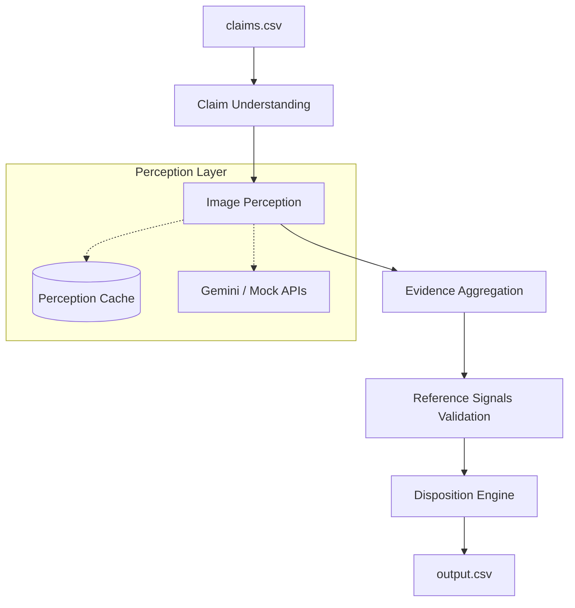

# Automated Claim Evidence Verification System

An autonomous, multimodal orchestration pipeline designed to verify damage claims by cross-referencing customer statements with uploaded visual evidence. 

This system extracts structured intent from conversational claims, runs robust image perception using Vision Language Models (VLMs), evaluates the findings against minimum evidence requirements, and produces a final deterministic adjudication status.

---

## Challenge Overview

**HackerRank Orchestrate (June 2026) — Multi-Modal Evidence Review**

The goal of this challenge is to build a reliable AI agent capable of reviewing damage claims. Evaluators provide a dataset of claims (including conversational transcripts and images) and business rules defining valid evidence. The system must process these inputs and generate a structured CSV with adjudication decisions (`supported`, `contradicted`, `not_enough_information`, or `manual_review_required`). 

This repository solves the challenge by combining deterministic rule engines with LLM-powered perception, ensuring that the final pipeline is both scalable and highly explainable.

---

## System Architecture

The pipeline is implemented as a directed flow where unstructured inputs are progressively refined into structured, evaluated signals.



---

## Approach

### 1. Claim Understanding
Extracts the core `claim_object` (e.g., car, laptop, package) and specific `object_part` from the conversational transcript. This layer normalizes synonyms (e.g., "back light" → "taillight") and detects conversational prompt injection attempts.

### 2. Image Perception
Processes uploaded images to identify visible objects, detect damage types (scratches, dents, cracks), and extract embedded text. Images are processed in batches where supported to minimize latency.

### 3. Evidence Aggregation
Synthesizes independent image-level perception results into a single cohesive claim representation. It resolves conflicts (e.g., if one image shows a scratch and another shows a dent) and flags inconsistencies like mismatched objects or impossible angles.

### 4. Reference Signals Validation
Evaluates the aggregated evidence against the minimum business requirements defined in `evidence_requirements.csv`. It cross-references the user's claim history from `user_history.csv` to apply dynamic risk profiling (e.g., lower trust for users with high previous rejection rates).

### 5. Disposition Logic
Applies deterministic business logic to emit a final `ClaimStatus`. Instead of relying on an LLM to "guess" the final status, this engine evaluates boolean signals (e.g., `claimed_part_visible`, `damage_matches_claim`, `fraud_indicators_present`) to guarantee reproducible and strictly compliant adjudications.

---

## Reliability Features

The system is designed for high availability and graceful degradation:

* **Perception Cache:** All VLM API responses are appended to a crash-safe `perception_cache.jsonl`. If the pipeline restarts or crashes, it resumes instantly without re-processing known images.
* **API Key Rotation:** The Gemini client supports comma-separated fallback keys to automatically bypass rate limits (`HTTP 429`).
* **Mock Fallbacks:** If external APIs are completely unreachable, the pipeline falls back to a deterministic Mock client, preventing total system failure.
* **Schema Validation:** Strict Pydantic models validate all inputs and outputs between pipeline stages, preventing silent failures from malformed data.
* **Recursion Protection:** Failsafe mechanisms prevent infinite loops when handling API rate limits or batch processing retries.

---

## Key Engineering Decisions

* **Deterministic Disposition over E2E Prompting:** Rather than passing the entire claim and images to a single LLM prompt and asking for a decision, the architecture splits perception (LLM) from disposition (Code). This allows precise tuning of business rules, avoids LLM hallucinations in the final output, and ensures deterministic grading.
* **Strict Schema Contracts:** Using Pydantic models for internal state ensures that any hallucinated or out-of-bounds enum values from the perception models are caught and handled at the boundary, rather than corrupting downstream logic.
* **Aggressive Caching:** Processing multimodal data is slow and expensive. The append-only JSONL cache dramatically speeds up development iterations and makes the system resilient to network interruptions.
* **Separation of Concerns:** Aggregating image results is separated from validating them against business rules. This allows multi-image logic to evolve independently of policy changes.

---

## Setup Instructions

### Clone the Repository
```bash
git clone <repository_url>
cd hackerrank-orchestrate-june26
```

### Environment Setup
```bash
python -m venv .venv

# Windows
.venv\Scripts\activate
# macOS/Linux
source .venv/bin/activate

pip install -r requirements.txt
```

### Configure Environment Variables
Create a `.env` file in the root directory:
```env
PERCEPTION_MODE=real
GEMINI_API_KEYS=key1,key2,key3
```

---

## Running The System

### Process the Full Dataset
```bash
python code/main.py
```

### Custom Input/Output Paths
```bash
python code/main.py --input dataset/claims.csv --output dataset/output.csv
```

### Running Tests
```bash
pytest tests/
```

---

## Output Format

The system produces a `output.csv` with the following strictly enforced columns:

* **`claim_status`**: `supported`, `contradicted`, `not_enough_information`, `manual_review_required`.
* **`severity`**: `low`, `medium`, `high`, `unknown`.
* **`issue_type`**: `scratch`, `dent`, `crack`, `water_damage`, etc.
* **`object_part`**: `front_bumper`, `screen`, `hinge`, `box`, etc.
* **`risk_flags`**: Semicolon-separated flags (e.g., `user_history_risk;text_instruction_present`).

---

## Testing

The repository maintains a robust test suite (79+ passing tests) utilizing `pytest`:

* **Unit Tests:** Isolated logic validation for aggregation, claim understanding, and disposition.
* **Schema Validation Tests:** Verifies all Pydantic boundaries.
* **Error Handling:** Validates pipeline resilience against corrupted caches and missing API keys.
* **End-to-End Tests:** Runs the full pipeline using mock perception data to guarantee complete data flow integrity.

---

## Limitations

* **Vision Model Ambiguity:** The system depends heavily on the VLM's ability to distinguish subtle differences (e.g., a glare vs. a liquid stain). Extreme lighting conditions can degrade accuracy.
* **Multi-Object Confusion:** Images containing multiple complex background objects may trigger false `claim_mismatch` flags if the perception model over-indexes on unrelated items.
* **API Quotas:** High-throughput processing is bottlenecked by external VLM rate limits, mitigated only partially by key rotation.

---

## Future Improvements

* **Confidence Calibration:** Plumb LLM confidence scores through the pipeline to dynamically adjust the threshold for `MANUAL_REVIEW_REQUIRED`.
* **Enhanced Injection Defense:** Implement an adversarial filtering step specifically trained to detect steganographic prompt injections in user images.
* **Multi-Provider Fallback:** Expand the perception client to fallback to Claude 3.5 Sonnet or GPT-4o if Gemini encounters sustained outages.

---

## Repository Structure

```text
.
├── code/
│   ├── main.py                     # Entry point for the orchestrator
│   ├── schemas.py                  # Core Pydantic contracts and Enums
│   ├── pipeline/
│   │   ├── orchestrator.py         # Main execution pipeline
│   │   ├── claim_understanding.py  # Transcript parsing
│   │   ├── perception_router.py    # Vision routing & caching
│   │   ├── image_analysis.py       # Evidence aggregation
│   │   ├── reference_signals.py    # Business rule validation
│   │   └── disposition.py          # Final adjudication logic
├── tests/                          # Pytest suite
├── dataset/                        # Input CSVs and images
├── logs/                           # System logs and perception cache
├── AGENTS.md                       # Competition agent guidelines
└── README.md                       # Documentation
```
